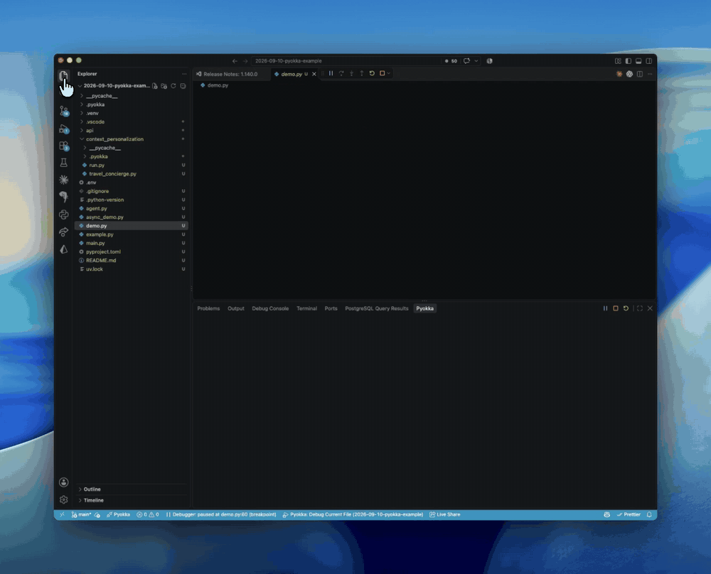

# Pyokka

Pyokka is a VS Code extension for Python. It shows runtime values next to your code as you type and has a time-travel debugger you can step through forwards and backwards. It is for Python developers in VS Code or Cursor, and for agents that need to ask what a program did. To try it: `gh release download --repo ivorpad/pyokka --pattern '*.vsix' && code --install-extension pyokka-*.vsix`, then open a Python file and press `Cmd/Ctrl+K Q`.

https://github.com/user-attachments/assets/f9330b28-e8c5-49f2-838b-2ce495ab4d8d

[](docs/media/pyokka.mp4)

*An agent drives the debugger from a terminal: `pyokka debug demo.py --at rrf --at reciprocal_rank
--at demo.py:124`, then `continue` and `step` from stop to stop. The editor shows each pause with
its values on the line, and the Pyokka panel has the call stack, the locals and the program's
output. Click it for [the video](docs/media/pyokka.mp4).*

It comes in four parts:

| Part | What it does | Start it |
|---|---|---|
| Run-all | runs the file on save, shows each line's value and which lines ran, and records every statement so the Time Machine steps back and forth through the run | `Cmd/Ctrl+K Q` on a Python file |
| Debugger | runs a script, a module or a server at full speed to a breakpoint, recording nothing unless asked | `F5` |
| `pyokka` command and MCP server | reads a recorded run and drives the debugger, for agents and terminals | `pyokka --help` |
| Browser page | the panel and a code pane in a browser tab, with a Scratchpad that tries code against a paused program | `pyokka web FILE --open` |

Inspired by [Quokka.js](https://quokkajs.com). Pyokka is an independent project, not affiliated
with Wallaby.js, the maker of Quokka, and contains no Quokka source code. Its command names,
settings and keys follow Quokka's.

[Install](#install) · [The `pyokka` command](#the-pyokka-command) · [MCP](#mcp) ·
[The skill](#the-skill) · [In Claude Code](#in-claude-code) · [In a browser](#in-a-browser) ·
[Use](#use) · [Commands](#commands) · [Settings](#settings) · [Files](#files-pyokka-writes) ·
[Development](#development) · [Every feature in depth](docs/GUIDE.md) · [Playbook](docs/PLAYBOOK.md)

## Install

Pyokka is not on the Marketplace yet. It needs VS Code 1.93 or newer (or Cursor) and Python 3.12
or newer.

1. Download the `.vsix` from the [latest release](https://github.com/ivorpad/pyokka/releases/latest).
2. In VS Code open the Extensions view (`Cmd/Ctrl+Shift+X`), click its `...` menu, choose
   **Install from VSIX...** and pick the file.
3. Run **Developer: Reload Window** in every VS Code window that was already open. Installing
   does not restart a running window.

From a terminal it is two commands. They need [`gh`](https://cli.github.com), and the `code`
command, which VS Code installs with **Shell Command: Install 'code' command in PATH**:

```sh
gh release download --repo ivorpad/pyokka --pattern '*.vsix' --clobber
code --install-extension pyokka-*.vsix --force   # Cursor: cursor --install-extension pyokka-*.vsix --force
```

### Requirements

Pyokka runs your file with a Python 3.12 or newer that you pick, the way VS Code's debugger runs
the interpreter selected in the Python extension. Nothing is installed into your environment: the
runtime is the standard library only and ships inside the extension.

It takes the first 3.12+ of: the `pyokka.python.interpreter` setting, the environment selected in
the Python extension, the project's `.venv` (or `venv`), `python.defaultInterpreterPath`, then
`python3` and `python` on the PATH. When none qualifies it opens a picker that lists the
interpreters on the machine with their versions, and saves the one you pick for the workspace.
"Pyokka: Select Python Interpreter for Pyokka" opens it any time.

A Mac with no Python 3.12+ needs one first:

| Where from | Admin password | Lands in |
|---|---|---|
| [python.org](https://www.python.org/downloads/macos/) installer | yes | `/usr/local/bin/python3` |
| Homebrew: `brew install python@3.13` | no, once Homebrew is set up | `/opt/homebrew/bin/python3` |
| uv: `uv python install 3.13 --default` | no | `~/.local/bin/python3` |
| pyenv, conda, or a project venv | no | found by the picker |

Apple's own `/usr/bin/python3` is too old (3.9 with the Command Line Tools, an installer
placeholder without them), and Pyokka never runs it.

The rest is per feature:

| Feature | Needs |
|---|---|
| The `pyokka` command, for agents | `pyokka.agentAccess` on, see [below](#the-pyokka-command) |
| The browser page | nothing: `node` 20+ when one is on PATH, else the Node inside VS Code |
| Narrate and the Tour | `claude` or `codex` on PATH, GitHub Copilot in VS Code, or `pyokka.explain.command` |
| Quick Package Install | nothing: `uv pip` when `uv` is on PATH, else `python -m pip` |

## The `pyokka` command

`pyokka` is the command line agents and terminals use, and what the MCP server, the browser page
and the Claude Code band run on. The extension installs it once you allow agent access:

1. Open Settings (`Cmd/Ctrl+,`), search `pyokka.agentAccess` and tick **Pyokka: Agent Access**,
   or add `"pyokka.agentAccess": true` to your user `settings.json`.
2. The extension writes `~/.local/bin/pyokka` at once: a script that runs the installed
   extension's own runtime, rewritten on every start so it follows upgrades. It needs no admin
   rights, and a file at that path that Pyokka did not write (a `uv tool install` symlink, say)
   is left alone.
3. Check it: `~/.local/bin/pyokka --help` prints the usage.

The setting is off by default because it also opens your VS Code window to local processes: each
session listens on a local socket, behind a token, through which an agent reads runs and drives
the debugger, `exec` included.

**On your PATH.** VS Code's own terminals find `pyokka` by name straight away. Other terminals need
`~/.local/bin` on their PATH, and a stock macOS does not have it there. The first time the
extension writes the script it offers to add the line to `~/.zprofile` (zsh) or `~/.bash_profile`
(bash; `~/.profile` on Linux). To add it yourself:

```sh
echo 'export PATH="$HOME/.local/bin:$PATH"' >> ~/.zprofile       # zsh, the macOS default
echo 'export PATH="$HOME/.local/bin:$PATH"' >> ~/.bash_profile   # bash on macOS
echo 'export PATH="$HOME/.local/bin:$PATH"' >> ~/.bashrc         # bash on Linux
fish_add_path ~/.local/bin                                        # fish
```

Then open a new terminal (a running one keeps its old PATH) and run `pyokka --help`.

**Windows** has no script yet. Run the extension's copy of the runtime:

```powershell
$ext = Get-ChildItem "$env:USERPROFILE\.vscode\extensions\ivor.pyokka-*" |
  Sort-Object { [version]($_.Name -replace '^ivor\.pyokka-', '') } | Select-Object -Last 1
$env:PYTHONPATH = "$($ext.FullName)\dist\python"
py -m pyokka_runtime --help   # or python, whichever runs Python 3.12+
```

**Without VS Code**, in a clone of this repository, `PYTHONPATH=python python3 -m pyokka_runtime
--help` runs the same CLI. `run`, the commands that read a saved run, and `web` (with Node 20+)
work there. `--live` and `debug` need a VS Code window with the extension.

## MCP

`pyokka mcp` serves the commands as 19 MCP tools ([the list](#mcp-tools)) over stdin/stdout.
Register the script by its full path, which works whatever PATH the client starts with:

```sh
claude mcp add pyokka -- ~/.local/bin/pyokka mcp                                 # Claude Code
codex mcp add pyokka -- ~/.local/bin/pyokka mcp                                  # Codex
mcporter config add pyokka --command ~/.local/bin/pyokka --arg mcp --scope home   # mcporter, for any agent with a shell
```

Other clients take it as JSON. Write the path out in full there, because JSON does not expand `~`:

```json
{ "mcpServers": { "pyokka": { "command": "/Users/YOU/.local/bin/pyokka", "args": ["mcp"] } } }
```

From a clone without the extension, the command is `python3` with `["-m", "pyokka_runtime",
"mcp"]` and `PYTHONPATH=<clone>/python` in its environment.

Give the tools absolute paths: the server resolves files against its own working directory.
`pyokka_debug` and `live: true` need VS Code with agent access on.

## The skill

`skills/pyokka` tells an agent which command answers which question. It is not part of the
extension, so link it from a clone:

```sh
git clone https://github.com/ivorpad/pyokka ~/pyokka
mkdir -p ~/.claude/skills ~/.agents/skills
ln -s ~/pyokka/skills/pyokka ~/.claude/skills/pyokka   # Claude Code
ln -s ~/pyokka/skills/pyokka ~/.agents/skills/pyokka    # Codex (its documented user location; older Codex read ~/.codex/skills)
```

`main` can be ahead of the latest release. `git -C ~/pyokka checkout vX.Y.Z` keeps the skill at
the version you installed.

For one project only, link it inside the repository instead: `.claude/skills/pyokka` for Claude
Code, `.agents/skills/pyokka` for Codex.

It loads only when asked by name: `/pyokka debug`, `/pyokka explain`, `/pyokka show` or
`/pyokka review` (`$pyokka ...` in Codex). With no mode it picks one from the request.

| mode | what it does |
|---|---|
| `debug` | pauses a running program at a function or line, steps it, reads or sets the frame; answers in chat |
| `explain` | walks a person through a run in their editor, one line and a few sentences per message |
| `show` | investigates a recording or a pause and hands over a code-history page |
| `review` | reviews a change as a guided debug session: a breakpoint per changed function, the entry under the debugger in VS Code, each pause recorded, a finding refused without a pause and a reproduction (`--full` records base and head and plans from the comparison) |

It finds the `pyokka` command by itself. Its code-history pages need Node.

The skill sets no model or effort of its own. Its reader-turn runs used Sonnet 5.5, and the
[playbook](docs/PLAYBOOK.md)'s runs of 2026-10-20 used Codex with gpt-6.1-sol. On 2026-10-16 it was
read against the vendors' guidance for Claude Opus 5.5, Claude Fable 5.1 and the GPT-6 family. It
has not been run on the two Claude models, and `docs/design/skill-model-compat.md` has the sources
and the ten-minute checks.

`review` is the mode for a pull request or a diff. `pyokka review start --base REF` plans one item
per changed function from the diff and starts the entry under the debugger in your VS Code, paused
on entry with a breakpoint on each item; the debugger is driven as always, and `review stop --say
TEXT` records the pause it is at, refusing an explanation that names none of the frame's values.
`--full` records the base and head trees instead, compares the two runs and plans the stops where
behaviour changed, and `review stop N --say TEXT` then moves the person's view (the browser page, a
VS Code recording, or chat) to a stop; `review try` reproduces a claim in the
Scratchpad's sandbox; `review finding add` refuses a finding without a step and a reproduction;
`review fix --patch` tries the fix on a copy; `review report` re-runs every reproduction before it
prints. Nothing is written inside the repository: the review lives under `$PYOKKA_HOME/reviews/`.
Over MCP the same actions are the `pyokka_review` tool, and the server offers the method as the
`review` prompt (`/mcp__pyokka__review` in Claude Code).

## In Claude Code

The Pyokka band is a Claude Code plugin. While an agent drives `pyokka ... --live`, it draws the
Time Machine of the VS Code session above the Claude Code prompt: the code at the step the agent
talks about, its values, the call stack and a short explanation.

```sh
claude plugin marketplace add ivorpad/pyokka
claude plugin install pyokka-band@pyokka
```

It is built on function hooks, an early-access Claude Code feature (Claude Code 2.1.269 or later,
tested on 2.1.287). Turn them on in `~/.claude/settings.json`:

```json
{ "env": { "CLAUDE_CODE_ENABLE_FUNCTION_HOOKS": "1" } }
```

The band runs `pyokka` by name, so `~/.local/bin` has to be on the PATH Claude Code started with,
and the VS Code window needs agent access on. `/pk` lists its keys, and
[the guide](docs/GUIDE.md#the-claude-code-band-in-depth) has the rest.

## In a browser

```sh
pyokka web app.py --open
```

serves the panel and a code pane at http://127.0.0.1:4777/: the Time Machine, the live debugger,
and the Scratchpad, which copies the function around a pause into a separate process with the
pause's values and runs your edits of it. It runs on `node` 20+ from PATH, else on the Node inside
VS Code. `--port N` moves it, `--no-run` opens it without running the file, and
`pyokka web ctl ...` drives it from a terminal. [docs/WEB.md](docs/WEB.md) is the reference.

The file's folder is the run's root and working directory, and `--cwd DIR` makes a DIR that holds
the file both: `pyokka web tests/test_routes.py --cwd .` treats the whole project as yours. Code
outside the root counts as library code, which the debugger does not enter unless the panel's
Settings > Step Into Library Code is on.

## Use

Open a Python file and press `Cmd/Ctrl+K Q`. The file runs, each line shows the value it produced,
the gutter shows which lines ran, and the Pyokka panel opens at the bottom. Save to run again. The
panel's Settings switch a session to run on every edit (Automatic), only when asked (On Demand),
or by kind of file (Smart). The first start opens a start view with an interactive demo, and
"Pyokka: Open Start View" brings it back.

| Action | Key |
|---|---|
| Start on the current file | `Cmd/Ctrl+K Q` |
| New Python file, session started | `Cmd/Ctrl+K J` |
| New file from a snippet or a recent file | `Cmd/Ctrl+K L` |
| Stop the current session | `Cmd+K S` (mac) / `Ctrl+K E` |
| Re-execute the file | `F5` (Time Machine idle, no breakpoint in the file) |
| Show value of the selection | `Cmd/Ctrl+K V` |
| Copy value | `Cmd/Ctrl+K X` |
| Clear a shown value / all shown values | `Esc` / `Esc Esc` |
| Install the missing package for this file | `Cmd/Ctrl+K I` |
| Start or stop the Time Machine on the current line | `Shift+F5` |
| Step over / back over | `F10` / `Ctrl+F10` |
| Step into / back into | `F11` / `Ctrl+F11` |
| Step out / back out | `Shift+F11` / `Ctrl+Shift+F11` |
| Run to / back to the cursor line | `F5` (no breakpoint in the file) / `Ctrl+F5` |
| Run to / back to a breakpoint | `F8` / `Ctrl+F8` |

In Cursor, which takes `Cmd+K` for itself, every `Cmd/Ctrl+K` chord is also `Ctrl+Alt+P` plus the
same letter.

`print()` output appears beside the call, a name alone on a line shows its value, and a comment
asks for more:

| Comment | Shows |
|---|---|
| `x  # ?` | the value of `x` |
| `x  # ?+` | the value, expanded deeper (depth 10 instead of 5) |
| `f()  # ?.` | how long the expression took, aggregated over its hits: count, total, min, max |
| `f()  # ?.+` or `# ?+.` | both |
| `s  # ? $.upper()` | the result of the code run against the value, `$` being the value |

`F5` depends on the state. With no Pyokka session on the file, or with a breakpoint in it, it starts
the Debugger. With a session and no breakpoint it re-executes the file, or runs to the cursor while
the Time Machine is on. During a debug session it is Continue.

## Commands

### In VS Code

Every command is under "Pyokka:" in the Command Palette.

- **Sessions:** Start on Current File (`Cmd/Ctrl+K Q`) · Toggle (Start/Stop) on Current File ·
  Re-execute file (`F5`) · Stop Current (`Cmd+K S` on macOS, `Ctrl+K E` elsewhere) · Stop All ·
  Run on save / Run automatically / Run on demand for Current File · Edit Current Pyokka Session
  Settings · Focus Active Pyokka File · Select Workspace Folder · Select Python Interpreter for
  Pyokka · Show Output · Focus Output · Show Logs · Open Start View · Show Instrumented Code ·
  Clear Library Cache
- **Values:** Show Value (`Cmd/Ctrl+K V`) · Show Line Value(s) · Show Line Timing(s) · Copy Value
  (`Cmd/Ctrl+K X`) · Clear Value (`Esc`) · Clear File Values (`Esc Esc`) · Toggle Show Value On
  Selection · Show Last Displayed Value Only / Show All Displayed Values · Toggle Auto Log (Enable
  / Disable) · Explore Value · Show Variable History · Why This Value
- **Time Machine:** Start Time Machine On The Current Line / Stop Time Machine (`Shift+F5`) · Start
  Time Machine With Auto Play (`Alt+Shift+F5`) · Auto Play Code · Pause Code Execution · View Code
  Story · Show/Hide Current Step Echo · Toggle Code Preview Display. The steps are the keys above.
- **Debugger:** Debug Current File · Debug Current File (Recording) · Continue, Pause, Step Over,
  Step Into, Step Out and Restart (Debug) · Stop Debugging · Show Debugger
- **Understanding a run:** Narrate Walkthrough · Show Tour · Narrate Tour · Show Execution Diagram
  · Show HTTP Requests · Open HTTP Recording · Profile · Investigate a Value · Learn from This Run ·
  Pin Run as Baseline · Verify Fix
- **Files, snippets, snaps, packages:** New Python File (`Cmd/Ctrl+K J`) · New File (`Cmd/Ctrl+K
  L`) · View Recent Files · Edit Pyokka Snippets · Create Snippet from Selection · Allow File Snaps
  Execution · Insert Snap Output · Delete Snap Output · Start / Stop Snaps Discovery in Current
  File · Install Missing Package into Project · Install Missing Package only for Pyokka File
  (`Cmd/Ctrl+K I`)

### The `pyokka` CLI

`RUN` is a saved recording, written by `pyokka run FILE --save run.json`. Commands that take a
`RUN` also take `--live` instead, for the session open in VS Code. Every command takes `--json`,
and `pyokka VERB --help` lists its flags.

```
pyokka run FILE --save RUN [--keep] [--cwd DIR] [--test NAME] [--python PATH] [--http record|replay] [--library-code] [--no-locals]   record one run of the file
pyokka story RUN [--file F | --scope NAME | --line F:L] [--limit LINES]   the lines that ran, in order, one block per scope
pyokka steps RUN [--from N --count K | --line F:L]                        step numbers with file:line and function
pyokka step  RUN N --into|--over|--out|--back|--back-over|--back-out|--to M [--scope]
pyokka context RUN N [--scope]        or   context RUN --line F:L [--scope]
pyokka values RUN --line F:L          every value logged on that line, by hit
pyokka find RUN TEXT [--limit K]      values, locals, errors, output and source lines that mention TEXT
pyokka var  RUN NAME [--file F] [--scope NAME] [--limit K]   every step where NAME changed: value, statement, what it read
pyokka why  RUN STEP [NAME] [--depth N]   why NAME had its value after STEP, five levels back
pyokka origin RUN STEP EXPR [--depth N]   where a bad value was made: the chain back across calls and containers, its root marked
pyokka coverage RUN [--file F]        per file the lines that ran, never ran and ran in part; --file lists one file with hit counts
pyokka diff BEFORE AFTER [--ignore NAME] [--limit K]   what an edit changed, statement by statement (--live: the session is the after)
pyokka tour RUN [--goal NAME|F:L] [--budget TOKENS] [--prose PATH] [--out PATH]   chapters and the steps worth a stop (docs/TOUR.md)
pyokka investigate RUN --value NAME [--at STEP]   one value's changes, why and origin, the run's exceptions, the lines that never ran
pyokka learn RUN [--at STEP --prediction TEXT] [--reveal]   checkpoints with their values hidden; predict one, then reveal it
pyokka pin RUN --out PATH             copy a run to a new owner-only file as a baseline; never overwrites
pyokka verify RUN --after PATH|--rerun [--expect NAME=VALUE] [--ignore NAME] [--test-out PATH]   the diff against a baseline and a PASS/FAIL per expected value; exit 1 on a FAIL
pyokka eval RUN EXPR                  a pure expression over the finished run: names, attributes, operators and calls that cannot change it (--keep or --live)
pyokka expand RUN VALUE_ID [--path SEGMENT ...]
pyokka state RUN                      file, step count, exit code, staleness (live: the Time Machine position)
pyokka watch --live                   one line per stop as the user steps
pyokka walkthrough RUN [--file F | --scope NAME | --from N --to M] [--all]
pyokka narrate RUN [--command CMD] [--dry-run]
pyokka graph RUN [--all | --expand PKG] [--scope NAME] [--no-statements] [--dot]
pyokka exceptions RUN
pyokka http RUN                       every request: method, status, the statement that made it, size, time, source
pyokka release RUN                    shut down the runner kept by --keep
pyokka cache [--clear]                the cache of instrumented library files: directory, entries, size; --clear empties it
pyokka debug [FILE | --module M] [--args ...] [--cwd DIR] [--env K=V] [--python PATH] [--at NAME|F:L] [--stop-on-entry] [--library-code] [--record] [--record-from NAME|F:L] [--configuration NAME] [--test NAME]   start the debugger and print the first stop (a FILE or --module implies --live)
pyokka debug --live [--stop-on-entry]   the same for the open session's file
pyokka restart --live [--stop-on-entry]   stop the program and start it again, in the same debug session
pyokka stop --live                    end the program; a debug session is then gone, a recording session and its run stay
pyokka continue --live [--no-wait | --until EXPR | --to F:L]   resume to the next stop, or `finished: exit N, K steps`; --no-wait answers `resumed` at once
pyokka pause --live [--no-wait]       pause the running program at its next statement; --no-wait answers `pause requested` at once
pyokka step --live --into|--over|--out [--count N]   run the program to its next stop; --count N takes N stops and prints the last
pyokka break --live [F:L ...] [--when EXPR] [--at NAME] [--remove F:L] [--list] [--log-message TEXT] [--clear] [--on-exception off|uncaught|raised]   breakpoints: list, add, remove (a def line pauses at every call), --at NAME a function's entry, --log-message a logpoint; where an exception pauses the run
pyokka watches --live [--add EXPR [--break-when change|true]] [--remove ID]   a watch expression shown at every stop; --break-when pauses the run on it instead
pyokka locals --live [--frame N] [--scope local|global|all] [--names-only] [--name NAME]   the paused frame's variables, one per line (--frame reads a caller frame)
pyokka record --live                  record from the current pause on, in a run started with --record-from that has not reached its point yet
pyokka exec --live SOURCE [--frame N]   run a statement in the paused frame: an assignment, a call, an import, a block; the program sees it when it continues
pyokka shell --live [--session NAME] [--json]   one command per stdin line over one connection: the one-shot words without --live, each result as the one-shot prints it
pyokka history RUN [--at STEP|F:L] [--var NAME] [--why STEP NAME] [--pause] --out PATH [--prose PATH] [--pad N] [--limit K] [--append]   the data behind a code-history page: the source each checkpoint needs, the values as of it, and the command that reproduces them
pyokka web FILE [--port N] [--cwd DIR] [--open] [--no-run] [--python PATH]   the browser page; `pyokka web ctl COMMAND` drives it, `pyokka web -h` lists the commands
pyokka review start --base REF [--repo DIR] [--entry FILE | --test NODEID] [--full] [--pr FILE] [--dir DIR]   review a change as a guided debug session; then pyokka continue --live to each item and review stop --say TEXT at the pause (--full: review stop N moves the view), ask, try, finding add, fix, report, state
pyokka mcp                            the commands as MCP tools, on stdin/stdout
```

`pyokka web ctl COMMAND` drives the browser page: `state`, `goto`, `step`, `line`, `say`, `clear`,
`start`, `stop`, `run`, `eval`, `peek`, `var`, `why`, `watch`, `break`, `debug`, `wait-pause`,
`story`, `profile`, `values`, `definition` and `scratchpad`. `pyokka web -h` has their flags.

### MCP tools

| tool | what it does |
|---|---|
| `pyokka_run` | records a file and returns the run path the other tools take |
| `pyokka_map` | state, walkthrough, story, steps, find, graph, exceptions, http, tour, diff |
| `pyokka_step` | the Time Machine at a step, and its moves |
| `pyokka_value` | var, why, origin, values, eval, expand, release |
| `pyokka_coverage` | which lines ran, never ran or ran in part |
| `pyokka_debug` | the live debugger in VS Code: start (a file, a module, a launch configuration, one test), continue, pause, stop, restart, break, watches, locals, exec, record, and `status` with `wait_seconds` to wait for the person's next pause; steps and `eval` go through `pyokka_step` and `pyokka_value` with `live` |
| `pyokka_history`, `pyokka_narrate` | the data behind a code-history page; a model's gloss per walkthrough moment |
| `pyokka_investigate`, `pyokka_learn`, `pyokka_pin`, `pyokka_verify` | the four verbs of the same names |
| `pyokka_session`, `pyokka_seek` | where a saved run or the open session stands, and the step where a value or a line first or last happened, as JSON |
| `pyokka_save_investigation`, `pyokka_open_investigation` | a question and named steps of a run kept in a file, reopened only while the run's sha256 is unchanged |
| `pyokka_page`, `pyokka_scratchpad` | the browser page: open it, then every `pyokka web ctl` command and the Scratchpad |
| `pyokka_review` | a change reviewed as a guided debug session: `start`, `stop`, `ask`, `try`, `finding`, `fix`, `report`, `state`; the server also serves the method as the `review` prompt |

## Settings

The ones people change:

| Setting (default) | What it does |
|---|---|
| `pyokka.agentAccess` (false) | installs the `pyokka` command and lets local agents use this window |
| `pyokka.python.interpreter` (`""`) | the Python that runs your files; empty picks one as [Requirements](#requirements) says |
| `pyokka.runMode` (`onSave`) | when a file runs: `onSave`, `auto`, `onDemand` or `smart` |
| `pyokka.runTimeout` (30000) | milliseconds before a run is stopped; 0 waits forever |
| `pyokka.autoLog` (false) | a value for every statement |
| `pyokka.timeMachine.recordLocals` (false) | record every local at every step |
| `pyokka.timeMachine.libraryCode` (false) | step into third-party packages |
| `pyokka.http` (`off`) | `record` the program's HTTP calls, or `replay` them without the network |
| `pyokka.secrets.mask` (true) | mask secret values before they leave the run |
| `pyokka.explain.command` (`""`) | the command Narrate calls; empty tries `claude`, `codex`, then Copilot |

Settings also come from `~/.pyokka/config.json`, `[tool.pyokka]` in `pyproject.toml` and a
`.pyokka` file, later ones winning. [Every setting](docs/GUIDE.md#settings-reference).

## Files Pyokka writes

| Path | What |
|---|---|
| `~/.pyokka/cache/` | Instrumented library files; `PYOKKA_CACHE_DIR` moves it, an empty value disables it; entries not rewritten for 30 days are swept; "Pyokka: Clear Library Cache" or `pyokka cache --clear` empties it |
| `~/.pyokka/recentFiles.json` | The recent files list |
| `~/.pyokka/pyokka.code-snippets` | Your Pyokka snippets |
| `~/.pyokka/sessions/*.json` | Live session descriptors while `pyokka.agentAccess` is on (`PYOKKA_SESSIONS_DIR` moves it) |
| `~/.pyokka/config.json` | Read as the second configuration layer; never written |
| `<workspace>/.pyokka/replay/<hash>.jsonl` | HTTP recordings (`.pyokka-replay/` when `.pyokka` is a config file) |
| a temporary `.cpuprofile` | Written by a profile run and opened in the editor |
| `~/.local/bin/pyokka` | The CLI script, while `pyokka.agentAccess` is on; rewritten on every activation |
| VS Code's workspace storage, `baselines/` | Runs kept by Pin Run as Baseline, for Verify Fix |
| `<file's folder>/.pyokka/runs/<name>.json` | Runs the MCP tool `pyokka_run` saves when it is given no `save` path |
| `~/.pyokka/scratchpads/<id>/<n>.json` | The browser page's saved scratchpads, one file per version, never overwritten |
| `~/.pyokka/recent.json` | The files the browser page's bridge ran (its View Recent Files) |
| `~/.pyokka/last-debug.json` | The last `pyokka debug` launch per directory, which `break`, `continue` and `restart` start again when no debug session is open |
| `~/.pyokka/reviews/<repo>-<base>/` | A review's plan, recordings, tries, fix and `report.md` (`--dir` moves it); `reviews/current` names the last one started |
| `~/.pyokka/tool-results/` | MCP results over 8,000 characters (`PYOKKA_MCP_MAX_CHARS`), whole and redacted, which the reply names; the newest 200 are kept, in the temp directory's `pyokka-tool-results/` when the home is not writable |

Otherwise the runtime never writes into your project, and the extension edits your files only for
Insert / Delete Snap Output and a `.gitignore` line you accept.

## Development

```sh
npm install
npm run build        # the extension, the webview and the Python runtime, into dist/
scripts/check.sh     # typecheck, vitest, pytest, a build and the band's plugin checks
node esbuild.mjs --production && ./node_modules/.bin/vsce package --no-dependencies   # the .vsix
```

`F5` in VS Code opens an Extension Development Host on `examples/`. `scripts/release.sh` cuts a
release: the checks, the version from the `Bump:` trailers, the changelog section, the build, a tag
and a GitHub release. The extension's protocol with the runtime is
[docs/PROTOCOL.md](docs/PROTOCOL.md). End-to-end tests, build notes, the project's status and its
known gaps are in [the guide](docs/GUIDE.md#development).

## License

MIT, see [LICENSE](LICENSE).
